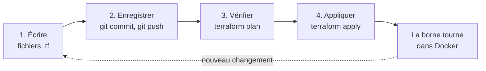

# TP Arcade as Code : déployer un jeu web en Infrastructure as Code

## Introduction

**Terraform** est l'outil d'Infrastructure as Code (IaC) de ce TP. Vous décrivez l'**état souhaité**, par exemple « un conteneur nginx qui sert le jeu sur le port 8080 », et Terraform se charge d'y arriver. Il travaille toujours en trois temps :

1. **Écrire** : vous décrivez l'état souhaité dans des fichiers `.tf`.
2. **Planifier** : `terraform plan` compare ce code à la réalité et affiche ce qu'il va créer, modifier ou supprimer. Rien ne change encore.
3. **Appliquer** : `terraform apply` exécute ce plan, après votre `yes`.

Terraform note ce qu'il a créé dans un fichier d'état, `terraform.tfstate` : c'est sa mémoire. Ce fichier peut contenir des secrets, il ne va donc jamais dans Git ([documentation](https://developer.hashicorp.com/terraform/language/state)).

Terraform ne parle pas à Docker tout seul : il passe par un **provider**, un module qui traduit le code en commandes Docker. Ici, c'est le provider `kreuzwerker/docker`.

Pour approfondir : [What is Terraform](https://developer.hashicorp.com/terraform/intro) (HashiCorp).



Chaque changement suit le même chemin : on modifie le code, on l'enregistre dans Git, on vérifie le plan, puis on applique. On ne touche jamais directement à Docker.

## Rappel : fichiers et commandes

Gardez ces tableaux sous la main pendant le TP. Chaque lien mène à la documentation officielle.

### Les fichiers du projet

| Fichier | À quoi il sert | Documentation |
| --- | --- | --- |
| `providers.tf` | Fige les versions de Terraform et du provider, indique où joindre Docker | [bloc terraform](https://developer.hashicorp.com/terraform/language/block/terraform), [bloc provider](https://developer.hashicorp.com/terraform/language/block/provider) |
| `variables.tf` | Déclare les paramètres : nom, type, description | [variables](https://developer.hashicorp.com/terraform/language/values/variables) |
| `terraform.tfvars` | Donne une valeur à chaque paramètre. Chargé automatiquement | [fichiers .tfvars](https://developer.hashicorp.com/terraform/language/values/variables#variable-definitions-tfvars-files) |
| `main.tf` | L'état souhaité : les ressources (image, conteneur, volume) | [bloc resource](https://developer.hashicorp.com/terraform/language/block/resource), [for\_each](https://developer.hashicorp.com/terraform/language/meta-arguments/for_each), [docker\_container](https://github.com/kreuzwerker/terraform-provider-docker/blob/master/docs/resources/container.md) |
| `outputs.tf` | Ce que Terraform affiche après le déploiement | [bloc output](https://developer.hashicorp.com/terraform/language/block/output) |
| `.terraform.lock.hcl` | Créé par `init` : fige la version exacte du provider. Se met dans Git | [lock file](https://developer.hashicorp.com/terraform/language/files/dependency-lock) |
| `terraform.tfstate` | Créé par `apply` : la mémoire de Terraform. Jamais dans Git | [state](https://developer.hashicorp.com/terraform/language/state) |

### Les commandes Terraform

| Commande | Ce qu'elle fait | Documentation |
| --- | --- | --- |
| `terraform init` | Télécharge le provider et prépare le dossier. Une fois au début | [init](https://developer.hashicorp.com/terraform/cli/commands/init) |
| `terraform fmt` | Remet le code en forme (indentation, alignement) | [fmt](https://developer.hashicorp.com/terraform/cli/commands/fmt) |
| `terraform validate` | Vérifie que le code est correct, sans rien déployer | [validate](https://developer.hashicorp.com/terraform/cli/commands/validate) |
| `terraform plan` | Montre ce qui va changer, sans rien toucher | [plan](https://developer.hashicorp.com/terraform/cli/commands/plan) |
| `terraform apply` | Affiche le plan, demande `yes`, puis l'exécute | [apply](https://developer.hashicorp.com/terraform/cli/commands/apply) |

Dans un plan, le symbole devant chaque ressource dit ce qui va arriver : `+` création, `~` modification sur place, `-/+` remplacement (suppression puis recréation), `-` suppression.

### Les commandes Git

| Commande | Ce qu'elle fait | Documentation |
| --- | --- | --- |
| `git clone <adresse>` | Copie un dépôt GitHub sur votre poste | [git clone](https://git-scm.com/docs/git-clone) |
| `git status` | Liste les fichiers modifiés depuis le dernier commit | [git status](https://git-scm.com/docs/git-status) |
| `git diff` | Montre les lignes modifiées (touche `q` pour sortir) | [git diff](https://git-scm.com/docs/git-diff) |
| `git add <fichier>` | Choisit les fichiers à enregistrer dans le prochain commit | [git add](https://git-scm.com/docs/git-add) |
| `git commit -m "message"` | Enregistre une version, avec un message qui dit pourquoi | [git commit](https://git-scm.com/docs/git-commit) |
| `git push` | Envoie vos commits sur GitHub | [git push](https://git-scm.com/docs/git-push) |
| `git log --oneline` | Affiche l'historique, un commit par ligne | [git log](https://git-scm.com/docs/git-log) |
| `git revert HEAD` | Annule le dernier commit en ajoutant un commit inverse | [git revert](https://git-scm.com/docs/git-revert) |

Pour débuter avec Git en français : [Les bases de Git](https://git-scm.com/book/fr/v2/Les-bases-de-Git-Enregistrer-des-modifications-dans-le-d%C3%A9p%C3%B4t) (livre Pro Git).

## La mission

Le studio fictif **Pixel Rétro** a créé un casse-briques jouable dans le navigateur. L'ancien stagiaire le lançait avec des commandes `docker run` tapées à la main, que personne n'a notées. Votre mission : décrire la borne d'arcade en code avec Terraform, la ranger dans Git, et la déployer en local dans Docker.

**Règle d'or :** on ne crée, ne modifie et ne supprime jamais un conteneur à la main, sauf quand le TP le demande. Tout passe par le code.

À la fin, vous aurez deux bornes qui tournent, un tableau d'honneur qui survit aux mises à jour, et un dépôt GitHub qui permet à n'importe qui de tout recréer.

## Installer les outils

Il faut un compte GitHub et quatre outils : Git, WSL 2, Docker Desktop et Terraform. Installez-les dans cet ordre et vérifiez chacun avant de passer au suivant.

**Matériel requis :** Windows 10 22H2 ou Windows 11 23H2 minimum, 8 Go de RAM, 10 Go d'espace libre, virtualisation activée dans le BIOS/UEFI. L'installation de WSL demande une fois les droits administrateur : si vous ne les avez pas, appelez l'enseignant.

Toutes les commandes se tapent dans **PowerShell** (menu Démarrer, tapez « PowerShell »). « PowerShell administrateur » = clic droit sur PowerShell, puis « Exécuter en tant qu'administrateur ».

### Compte GitHub

Créez un compte sur [github.com](https://github.com/signup) si vous n'en avez pas, et notez votre nom d'utilisateur.

### Git

1. Téléchargez Git for Windows sur [git-scm.com/download/win](https://git-scm.com/download/win) et lancez l'installateur. Les options par défaut conviennent.
2. Fermez puis rouvrez PowerShell.
3. Vérifiez, puis indiquez votre identité. Elle signera chacun de vos commits :

```powershell
git --version
git config --global user.name "Prénom Nom"
git config --global user.email "prenom.nom@ecole.fr"
```

✅ Attendu : `git version 2.x`.

### WSL 2 (le moteur Linux de Windows, requis par Docker)

Dans un PowerShell **administrateur** :

```powershell
wsl --install --no-distribution
```

Redémarrez si Windows le demande. Si WSL était déjà installé, mettez-le à jour avec `wsl --update`. Vérifiez ensuite dans un PowerShell normal :

```powershell
wsl --version
```

✅ Attendu : « Version WSL » 2.1.5 ou plus, minimum exigé par [Docker](https://docs.docker.com/desktop/setup/install/windows-install/).

### Docker Desktop

1. Téléchargez **Docker Desktop for Windows (x86\_64)** depuis la [documentation Docker](https://docs.docker.com/desktop/setup/install/windows-install/).
2. Lancez l'installateur, choisissez l'installation **per-user** et laissez cochée l'option WSL 2.
3. Ouvrez Docker Desktop et acceptez les conditions. Il est gratuit pour un usage éducatif ; aucun compte Docker n'est nécessaire.
4. Attendez l'indication « Engine running », puis vérifiez :

```powershell
docker version
docker run --rm hello-world
```

✅ Attendu : `docker version` affiche deux blocs, Client et Server ; `hello-world` affiche « Hello from Docker! ».

### Terraform

1. Téléchargez le zip **Windows AMD64** de Terraform 1.16.6 (version stable au 19 octobre 2026) sur la [page officielle](https://developer.hashicorp.com/terraform/install).
2. Créez le dossier `C:\outils\terraform` et extrayez-y `terraform.exe`.
3. Ajoutez ce dossier à votre PATH, sans droits administrateur :

```powershell
[Environment]::SetEnvironmentVariable("Path", [Environment]::GetEnvironmentVariable("Path", "User") + ";C:\outils\terraform", "User")
```

4. Fermez puis rouvrez PowerShell, et vérifiez :

```powershell
terraform version
```

✅ Attendu : `Terraform v1.16.6 on windows_amd64`.

### Éditeur

Installez [Visual Studio Code](https://code.visualstudio.com/) en laissant cochée l'option « Ajouter à PATH », puis, dans l'onglet Extensions, l'extension **HashiCorp Terraform** : elle colore le code et signale les erreurs.

## Étape 0 : récupérer le jeu

Le jeu est fourni sous forme de **modèle GitHub** : [github.com/Louis-SCHWARTZ/arcade-iac-starter](https://github.com/Louis-SCHWARTZ/arcade-iac-starter). Vous en faites votre propre dépôt, dans votre compte ([documentation GitHub](https://docs.github.com/fr/repositories/creating-and-managing-repositories/creating-a-repository-from-a-template)).

1. Connecté à GitHub, ouvrez la page du modèle et cliquez sur le bouton vert **Use this template** › **Create a new repository**.
2. Owner : votre compte. Repository name : `arcade-iac`. Visibilité : **Public**.
3. Cliquez sur **Create repository**.

Copiez ensuite le dépôt sur votre poste. Dans PowerShell, remplacez `<votre-compte>` par votre nom d'utilisateur GitHub :

```powershell
cd $HOME\Documents
git clone https://github.com/<votre-compte>/arcade-iac.git
cd arcade-iac
code .
```

`code .` ouvre le dossier dans VS Code. Si la commande `code` est inconnue, ouvrez VS Code puis **Fichier** › **Ouvrir le dossier** et choisissez `Documents\arcade-iac`.

À partir d'ici, tapez toutes les commandes dans le terminal de VS Code (menu **Terminal** › **Nouveau terminal**) : c'est un PowerShell déjà placé dans le dossier `arcade-iac`.

```powershell
git log --oneline
```

✅ Attendu : un seul commit, celui du modèle. L'explorateur de VS Code montre `README.md`, `TP.md` (ces consignes) et le dossier `app` (le jeu : `index.html`, `style.css`, `game.js`).

Pour voir le jeu, lancez :

```powershell
start app\index.html
```

Le jeu s'ouvre dans votre navigateur (flèches ou souris, Espace pour lancer). L'adresse commence par `file://` : le navigateur lit un fichier sur votre disque. Le jeu n'est pas encore déployé sur un serveur web.

### Connecter Git à GitHub

Pour envoyer votre travail sur GitHub, Git doit être autorisé à utiliser votre compte. Git for Windows s'en charge au premier envoi. Faites un envoi de test :

```powershell
git commit --allow-empty -m "Tester la connexion à GitHub"
git push
```

Une fenêtre « Connect to GitHub » s'ouvre : cliquez sur **Sign in with your browser**, connectez-vous si besoin, puis autorisez **Git Credential Manager**. Git mémorise cette autorisation : vous ne la referez plus.

✅ Attendu : `git push` se termine par une ligne `main -> main`. Sur la page GitHub de votre dépôt, le commit « Tester la connexion à GitHub » apparaît.

## Étape 1 : décrire la borne en code

Vous écrivez l'état souhaité de la borne. À la fin de cette étape, rien n'est encore déployé : écrire n'est pas déployer.

### 1.1 Protéger le dépôt

Créez le fichier `.gitignore` à la racine du dépôt (dans `arcade-iac`, pas dans `app`). Il liste ce que Git doit ignorer : ici, les fichiers de travail de Terraform et son état, qui peut contenir des secrets.

```text
# Dossier de travail de Terraform
.terraform/

# Etat de Terraform : jamais dans Git
*.tfstate
*.tfstate.*

# Journaux de plantage
crash.log
```

Enregistrez cette première version :

```powershell
git add .gitignore
git commit -m "Ignorer l'état de Terraform"
```

### 1.2 Écrire les fichiers Terraform

Créez un dossier `infra` à la racine du dépôt, puis les cinq fichiers ci-dessous dans ce dossier. Le rôle de chaque fichier et le lien vers sa documentation sont dans le tableau du début.

```text
arcade-iac/
├── .gitignore
├── README.md
├── TP.md               ← ces consignes (fourni)
├── app/                  ← le jeu (fourni)
└── infra/
    ├── providers.tf
    ├── variables.tf
    ├── terraform.tfvars
    ├── main.tf
    └── outputs.tf
```

`infra/providers.tf` fige les versions et indique où joindre Docker Desktop :

```hcl
# Versions figées : tout le monde obtient exactement les mêmes outils.
terraform {
  required_version = ">= 1.6.0, < 2.0.0"

  required_providers {
    docker = {
      source  = "kreuzwerker/docker"
      version = "4.6.0"
    }
  }
}

# Comment joindre le moteur Docker de Docker Desktop.
provider "docker" {
  host = "npipe:////./pipe/docker_engine"
}
```

`infra/variables.tf` déclare les deux paramètres de la borne :

```hcl
variable "image_web" {
  description = "Image Docker du serveur web"
  type        = string
}

variable "bornes" {
  description = "Les bornes à déployer : un nom et un port par borne"
  type        = map(number)
}
```

`infra/terraform.tfvars` leur donne une valeur. Pour l'instant, une seule borne, nommée `accueil`, sur le port 8080 :

```hcl
image_web = "nginx:alpine"

bornes = {
  accueil = 8080
}
```

`infra/main.tf` est le cœur du TP. Il décrit deux ressources : l'image `nginx:alpine` (un petit serveur web) et un conteneur par borne. `for_each` crée une borne par ligne de la variable `bornes` : `each.key` est son nom, `each.value` son port.

```hcl
# L'image du serveur web, téléchargée une fois depuis Docker Hub.
resource "docker_image" "web" {
  name         = var.image_web
  keep_locally = true
}

# Une borne (un conteneur) par ligne de la variable « bornes ».
resource "docker_container" "borne" {
  for_each = var.bornes

  name    = "arcade-${each.key}"
  image   = docker_image.web.image_id
  restart = "unless-stopped"

  # Le jeu est joignable sur ce poste uniquement, au port choisi.
  ports {
    internal = 80
    external = each.value
    ip       = "127.0.0.1"
  }

  # Les trois fichiers du jeu, copiés dans le conteneur.
  # source_hash : si un fichier change, Terraform le voit.
  upload {
    file        = "/usr/share/nginx/html/index.html"
    source      = "${path.module}/../app/index.html"
    source_hash = filesha256("${path.module}/../app/index.html")
  }
  upload {
    file        = "/usr/share/nginx/html/style.css"
    source      = "${path.module}/../app/style.css"
    source_hash = filesha256("${path.module}/../app/style.css")
  }
  upload {
    file        = "/usr/share/nginx/html/game.js"
    source      = "${path.module}/../app/game.js"
    source_hash = filesha256("${path.module}/../app/game.js")
  }
}
```

`infra/outputs.tf` affiche l'adresse de chaque borne après le déploiement :

```hcl
output "adresses" {
  description = "L'adresse de chaque borne, à ouvrir dans le navigateur"
  value       = { for nom, port in var.bornes : nom => "http://localhost:${port}" }
}
```

### 1.3 Initialiser et vérifier

Placez-vous dans le dossier `infra` : toutes les commandes `terraform` se lancent depuis ce dossier, là où sont les fichiers `.tf`.

```powershell
cd infra
terraform init
```

`terraform init` lit `providers.tf`, télécharge le provider `kreuzwerker/docker` en version 4.6.0 dans un dossier `.terraform`, et crée `.terraform.lock.hcl`, qui note la version exacte téléchargée.

✅ Attendu : une ligne `Installed kreuzwerker/docker v4.6.0`, puis `Terraform has been successfully initialized!`

```powershell
terraform fmt
terraform validate
```

`terraform fmt` remet le code en forme. Il affiche le nom des fichiers qu'il a corrigés, ou rien s'ils étaient déjà propres. `terraform validate` vérifie le code sans rien déployer : accolade manquante, variable mal orthographiée, mauvais type.

✅ Attendu : `Success! The configuration is valid.` En cas d'erreur, Terraform indique le fichier et la ligne : corrigez, puis relancez `terraform validate`.

Enregistrez votre travail et envoyez-le sur GitHub :

```powershell
cd ..
git status
git add infra
git commit -m "Décrire la borne d'arcade avec Terraform"
git push
```

✅ Attendu : `git status` liste `infra/` mais pas le dossier `.terraform/`, ignoré grâce au `.gitignore`. Sur GitHub, votre dépôt montre le dossier `infra`. `docker ps` n'affiche toujours aucun conteneur.

## Étape 2 : déployer

D'abord, demandez à Terraform ce qu'il **va** faire :

```powershell
cd infra
terraform plan
```

✅ Attendu : deux ressources précédées de `+` (l'image et la borne `accueil`) et `Plan: 2 to add, 0 to change, 0 to destroy.` Rien n'est encore créé.

Puis déployez :

```powershell
terraform apply
```

Terraform réaffiche le plan et attend votre accord : tapez `yes`.

✅ Attendu : `Apply complete! Resources: 2 added`, puis l'adresse de la borne : `accueil = "http://localhost:8080"`. Ouvrez-la et jouez une partie.

Vérifiez ce qui tourne, puis relancez un plan :

```powershell
docker ps
terraform plan
```

✅ Attendu : `docker ps` montre le conteneur `arcade-accueil` sur `127.0.0.1:8080->80/tcp`. Le plan répond `No changes` : la réalité correspond déjà au code, Terraform n'a rien à faire. Relancer `apply` ne casse rien.

Un fichier `terraform.tfstate` est apparu dans `infra` : c'est la mémoire de Terraform. `git status` ne le montre pas, grâce au `.gitignore`.

**Si l'apply échoue avec une erreur de connexion à Docker**, vérifiez que Docker Desktop est démarré. Si c'est le cas, lancez `docker context inspect --format "{{.Endpoints.docker.Host}}"` et recopiez l'adresse affichée dans `host`, dans `providers.tf`.

## Étape 3 : modifier le jeu et redéployer

Le studio veut afficher le nom de la borne dans l'onglet du navigateur. Avec l'IaC, on ne touche pas au conteneur : on modifie le code, on l'enregistre, puis on applique.

Dans `app/index.html`, remplacez la ligne du titre par :

```html
<title>Pixel Rétro : borne accueil</title>
```

Relisez la modification, puis enregistrez-la :

```powershell
cd ..
git diff
git commit -am "Afficher le nom de la borne dans le titre"
git push
```

`git diff` montre en rouge l'ancienne ligne et en vert la nouvelle. Tapez `q` pour sortir. `commit -am` enregistre directement les fichiers déjà suivis par Git.

Appliquez maintenant le changement :

```powershell
cd infra
terraform plan
terraform apply
```

✅ Attendu : `docker_container.borne["accueil"] must be replaced` et `Plan: 1 to add, 0 to change, 1 to destroy.` Le fichier a changé, donc son empreinte aussi (`# forces replacement`) : Terraform recrée le conteneur avec le nouveau fichier. Après `yes`, rechargez la page avec **Ctrl+F5** : l'onglet affiche le nouveau titre.

Le code dans Git et la borne déployée sont identiques : c'est tout l'intérêt de l'IaC.

## Étape 4 : une erreur en production

Un collègue veut changer d'image et fait une faute de frappe. Vous allez reproduire son erreur, puis utiliser Git pour la retrouver et l'annuler.

Dans `infra/terraform.tfvars`, remplacez la première ligne par celle-ci, **avec la faute** (`alpin` au lieu de `alpine`) :

```hcl
image_web = "nginx:alpin"
```

Enregistrez avec un message peu clair, comme l'a fait votre collègue, puis appliquez :

```powershell
cd ..
git commit -am "maj"
git push
cd infra
terraform apply
```

Lisez le plan avant de taper `yes` : il annonce la suppression de la borne et de l'image. Tapez `yes` quand même.

✅ Attendu : Terraform supprime la borne, puis échoue sur `nginx:alpin`, une image qui n'existe pas. La page http://localhost:8080 ne répond plus : la borne est en panne.

**Retrouver la cause.** Git garde l'historique de chaque changement. Commencez par la liste des derniers commits :

```powershell
git log --oneline -3
```

Chaque ligne donne l'identifiant court d'un commit et son message, le plus récent en haut. Le dernier s'appelle « maj » : le message ne dit rien. Regardez ce qu'il contient :

```powershell
git show HEAD
```

`HEAD` désigne le dernier commit. Git affiche son auteur, sa date, son message, puis les lignes modifiées : `-` devant l'ancienne ligne, `+` devant la nouvelle.

✅ Attendu, dans le bas de l'affichage :

```text
-image_web = "nginx:alpine"
+image_web = "nginx:alpin"
```

Vous savez maintenant qui a changé quoi, et quand. Tapez `q` pour sortir. Si des `^M` apparaissent en fin de ligne, ignorez-les : ce sont les fins de ligne Windows.

**Annuler.** `git revert` ajoute un nouveau commit qui fait l'inverse du commit fautif. L'erreur et sa correction restent visibles dans l'historique :

```powershell
git revert HEAD --no-edit
git push
git log --oneline -3
terraform apply
```

✅ Attendu : `git log` montre `Revert "maj"` au-dessus de `maj`. Le plan annonce `Plan: 2 to add`, et après `yes` la borne refonctionne.

Retenez deux choses : un plan se lit avant de taper `yes`, et un message de commit dit **pourquoi** on change quelque chose, pas juste « maj ».

## Étape 5 : la dérive

La **dérive** est l'écart entre ce que dit le code et ce qui tourne vraiment. Elle apparaît quand quelqu'un modifie l'infrastructure à la main, sans passer par le code.

**Le scénario.** Vendredi soir, un technicien arrête la borne à la main pour la nettoyer, et oublie de la relancer. Lundi matin, l'écran de l'accueil est noir.

Jouez le technicien :

```powershell
docker stop arcade-accueil
```

Rechargez http://localhost:8080 : la page ne répond plus. Vous arrivez lundi matin. Demandez à Terraform ce qui ne va pas :

```powershell
terraform plan
```

✅ Attendu : Terraform a vu que la réalité ne correspond plus au code. Il affiche `must_run = false -> true` (le code veut une borne allumée, elle est éteinte), `docker_container.borne["accueil"] must be replaced` et `Plan: 1 to add, 0 to change, 1 to destroy.`

Réparez avec le code, sans chercher la bonne commande `docker` :

```powershell
terraform apply
```

✅ Attendu : après `yes`, la borne refonctionne. Un second `terraform plan` répond `No changes`.

Terraform ramène la réalité vers le code, mais seulement quand quelqu'un lance `plan` ou `apply`, et seulement pour ce qu'il gère. Remarquez aussi que `git log` ne montre rien de cet incident : le changement a contourné le dépôt. D'où la règle d'or.

## Étape 6 : garder les données

**Le besoin.** Le RECORD affiché en haut du jeu ne vit que dans votre navigateur : chaque joueur voit le sien. Le gérant veut un **tableau d'honneur** commun, affiché par la borne à tous les joueurs. Il y inscrit lui-même les meilleurs scores, dans un fichier `records/top.txt` rangé sur la borne.

### 6.1 Ajouter le tableau d'honneur au jeu

Dans `app/index.html`, ajoutez ce bloc juste avant la ligne `<footer class="pied">` :

```html
    <section class="hud" style="grid-template-columns: 1fr; margin-top: 10px" aria-label="Tableau d'honneur">
      <div><span class="etiquette">TABLEAU D'HONNEUR</span><span id="honneur" style="white-space: pre-line">AUCUN RECORD</span></div>
    </section>
```

Puis, juste après la ligne `<script src="game.js"></script>`, ajoutez :

```html
  <script>
    fetch("records/top.txt", { cache: "no-store" })
      .then(function (reponse) { if (reponse.ok) return reponse.text(); })
      .then(function (texte) { if (texte) document.getElementById("honneur").textContent = texte; });
  </script>
```

Ce script lit le fichier `records/top.txt` sur la borne et affiche son contenu. Tant que le fichier n'existe pas, le tableau affiche « AUCUN RECORD ».

Enregistrez et déployez, comme à l'étape 3 :

```powershell
cd ..
git commit -am "Ajouter le tableau d'honneur"
git push
cd infra
terraform apply
```

✅ Attendu : après `yes`, rechargez la page avec **Ctrl+F5**. Sous l'écran de jeu, le tableau d'honneur affiche « AUCUN RECORD ».

### 6.2 Le gérant inscrit un record

Le gérant écrit le meilleur score du jour dans le fichier, sur la borne :

```powershell
docker exec arcade-accueil sh -c "mkdir -p /usr/share/nginx/html/records && echo 'LOU 12500' > /usr/share/nginx/html/records/top.txt"
```

Écrire une donnée n'est pas modifier l'infrastructure : c'est le travail normal du gérant, la règle d'or ne l'interdit pas.

✅ Attendu : rechargez la page, le tableau d'honneur affiche `LOU 12500`.

### 6.3 La mise à jour suivante efface le record

Le studio publie une nouvelle version du jeu. Dans `app/index.html`, dans le pied de page, remplacez `v1.0` par `v1.1` :

```html
      <span id="version">v1.1</span>
```

```powershell
cd ..
git commit -am "Passer le jeu en version 1.1"
git push
cd infra
terraform apply
```

✅ Attendu : le plan annonce le remplacement de la borne (`must be replaced`). Après `yes` et Ctrl+F5, le pied de page affiche `v1.1`, mais le tableau d'honneur affiche de nouveau « AUCUN RECORD ».

Le record était écrit dans l'ancien conteneur, et Terraform a supprimé ce conteneur pour le remplacer. Un conteneur est jetable : tout ce qui est écrit dedans disparaît avec lui.

### 6.4 Ranger les records dans un volume

Pour garder des données, on utilise un **volume** : un espace de stockage géré par Docker, indépendant du conteneur ([docker_volume](https://github.com/kreuzwerker/terraform-provider-docker/blob/master/docs/resources/volume.md)).

Dans `infra/main.tf`, ajoutez cette ressource juste avant `resource "docker_container" "borne"` :

```hcl
# Un volume : un espace de stockage qui survit aux conteneurs.
resource "docker_volume" "records" {
  name = "arcade-records"
}
```

Puis, dans la ressource `docker_container`, juste après le bloc `ports`, ajoutez :

```hcl
  # Le dossier records/ du site est rangé dans le volume.
  volumes {
    volume_name    = docker_volume.records.name
    container_path = "/usr/share/nginx/html/records"
  }
```

Appliquez, puis enregistrez :

```powershell
terraform plan
terraform apply
git commit -am "Ranger les records dans un volume"
git push
```

✅ Attendu : le plan annonce le volume (`docker_volume.records will be created`) et le remplacement de la borne.

Le gérant inscrit de nouveau son record, avec la même commande qu'en 6.2 :

```powershell
docker exec arcade-accueil sh -c "mkdir -p /usr/share/nginx/html/records && echo 'LOU 12500' > /usr/share/nginx/html/records/top.txt"
```

Puis le studio publie la version suivante. Dans `app/index.html`, remplacez `v1.1` par `v1.2`, et déployez :

```powershell
cd ..
git commit -am "Passer le jeu en version 1.2"
git push
cd infra
terraform apply
```

✅ Attendu : après `yes` et Ctrl+F5, le pied de page affiche `v1.2` et le tableau d'honneur affiche toujours `LOU 12500`. Le conteneur est neuf, les records sont restés dans le volume.

Terraform gère le volume, le contenant, mais pas ce qu'il y a dedans. Sauvegarder les données reste un travail à part.

## Étape 7 : une deuxième borne en une ligne

Le studio installe une seconde borne dans le salon. Le travail des étapes précédentes est fait une fois pour toutes : ajouter une borne, c'est ajouter **une ligne**.

Dans `infra/terraform.tfvars`, ajoutez la borne `salon` sur le port 8081 :

```hcl
bornes = {
  accueil = 8080
  salon   = 8081
}
```

```powershell
terraform plan
```

✅ Attendu : seule la nouvelle borne apparaît, `docker_container.borne["salon"] will be created`, avec `Plan: 1 to add, 0 to change, 0 to destroy.` La borne `accueil` n'est pas touchée.

```powershell
terraform apply
docker ps
```

✅ Attendu : après `yes`, Terraform affiche les deux adresses. `docker ps` montre `arcade-accueil` et `arcade-salon`. Ouvrez http://localhost:8081 : même jeu, et le tableau d'honneur affiche `LOU 12500`, car les deux bornes partagent le volume des records.

Enregistrez :

```powershell
git commit -am "Ajouter la borne du salon"
git push
```

Dix bornes demanderaient dix lignes. Et pour retirer une borne, on supprime sa ligne : le plan annonce alors `1 to destroy` pour elle seule. Essayez avec une troisième borne sur le port 8082, puis retirez-la.

Votre dépôt GitHub contient désormais tout : n'importe qui peut recréer vos bornes à l'identique avec `git clone`, `terraform init` et `terraform apply`.

## Défi

**La demande.** Le gérant ne sait plus quelle borne est laquelle. Chaque borne doit afficher son propre nom dans le pied de page, à la place de « © Pixel Rétro » : par exemple « BORNE ACCUEIL » sur l'une, « BORNE SALON » sur l'autre.

**Les contraintes.**

- Un seul code pour toutes les bornes : pas un fichier ni un bloc par borne.
- Ajouter une borne `bar` sur le port 8082 ne demande toujours qu'une ligne dans `terraform.tfvars`, et elle affiche son nom sans autre modification.
- Aucune commande `docker` à la main.

**Indices.**

- Le bloc `upload` ne sert pas qu'à copier un fichier existant : relisez sa [documentation](https://github.com/kreuzwerker/terraform-provider-docker/blob/master/docs/resources/container.md).
- Votre page sait déjà lire un fichier texte sur la borne.

✅ Le défi est réussi quand les trois bornes affichent chacune leur nom, que `terraform plan` répond `No changes`, et que votre travail est enregistré sur GitHub.

## Ressources

Les liens vers la documentation de chaque fichier et commande sont dans le tableau du début.

### Sources

- [What is Terraform](https://developer.hashicorp.com/terraform/intro) et [Install Terraform](https://developer.hashicorp.com/terraform/install), HashiCorp : cycle de travail, version 1.16.6.
- [State](https://developer.hashicorp.com/terraform/language/state) et [Dependency Lock File](https://developer.hashicorp.com/terraform/language/files/dependency-lock), HashiCorp : l'état peut exposer des secrets ; le fichier de verrouillage se met dans Git.
- [Provider kreuzwerker/docker](https://github.com/kreuzwerker/terraform-provider-docker) : ressources [docker\_container](https://github.com/kreuzwerker/terraform-provider-docker/blob/master/docs/resources/container.md) et [docker\_volume](https://github.com/kreuzwerker/terraform-provider-docker/blob/master/docs/resources/volume.md), version 4.6.0.
- [Install Docker Desktop on Windows](https://docs.docker.com/desktop/setup/install/windows-install/), Docker : prérequis, installation per-user, WSL 2.1.5 minimum.
- [Git for Windows](https://git-scm.com/download/win) et [documentation Git](https://git-scm.com/docs).
- [Création d'un dépôt à partir d'un modèle](https://docs.github.com/fr/repositories/creating-and-managing-repositories/creating-a-repository-from-a-template), GitHub.
